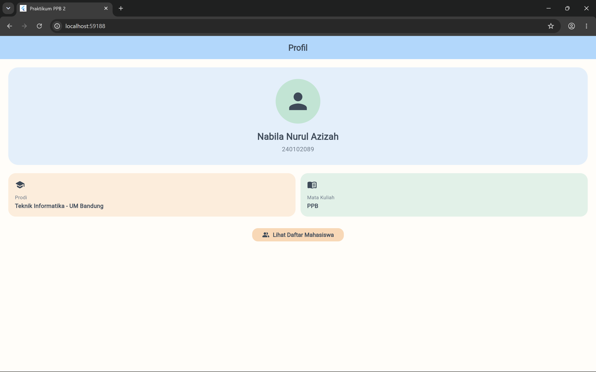
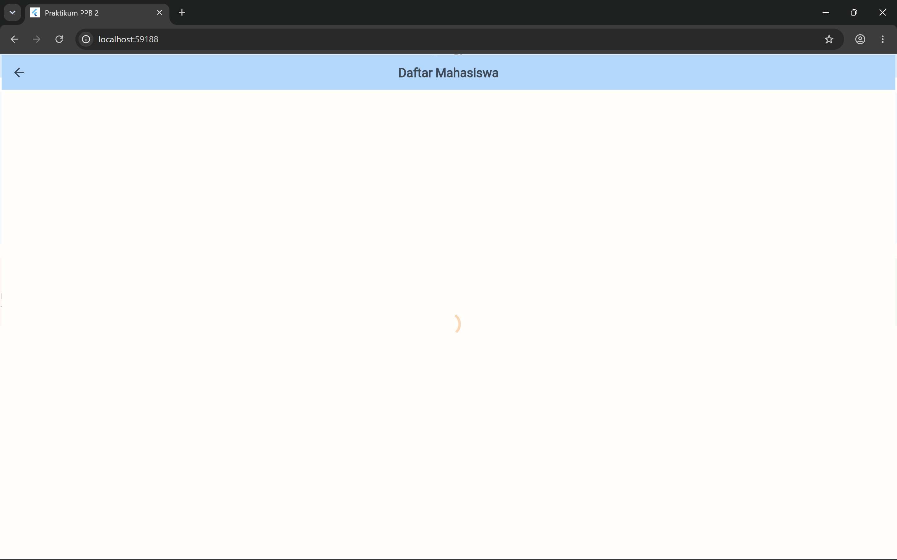

# ppb2_app — Tugas Praktikum 2 Perorangan (Widget & Dart Dasar)

Aplikasi Flutter dua halaman dengan tema pastel cerah.

## Fitur

1. **Halaman Profil (StatelessWidget)** — `Container` + `Column` untuk foto/identitas, `Row` untuk info singkat.
2. **Halaman Daftar Mahasiswa (StatefulWidget)** — `FutureBuilder` → `ListView.builder` dari API `https://jsonplaceholder.typicode.com/users`, model `User.fromJson`.
3. **Pull-to-refresh** — `RefreshIndicator` memanggil ulang fetch. Jika gagal, tampil SnackBar **"Gagal load — cek koneksi"**.
4. **Clean code** — `const` dipakai di mana pun memungkinkan, null safety, dan akses API dipisah ke `lib/services/api_service.dart`.

## Palet warna

| Peran     | Warna     |
|-----------|-----------|
| Primary   | `#A8D8FF` |
| Secondary | `#FFD6B3` |
| Accent    | `#B9E5D3` |

## Struktur

```
lib/
├── main.dart
├── models/user.dart
├── services/api_service.dart
├── theme/app_theme.dart
└── pages/
    ├── profile_page.dart
    └── user_list_page.dart
```

## Cara menjalankan

```bash
flutter create .          # sekali saja, untuk membuat folder android/ios/web
flutter pub get
flutter run
```

> Android: pastikan `android/app/src/main/AndroidManifest.xml` memiliki
> `<uses-permission android:name="android.permission.INTERNET"/>`.

## Screenshot

| Halaman Profil | Daftar Mahasiswa |
|----------------|------------------|
|  |  |

## Identitas

- Nama: Nabila Nurul Azizah
- NIM: 240102089
- Mata kuliah: Pemrograman Perangkat Bergerak (Praktikum 2)

## Pengumpulan

- Repo public: `ppb2-NIM`
- Upload ke LMS UM Bandung: PDF berisi link repo + 2 screenshot, nama file `NIM_Nama_Praktikum2`
